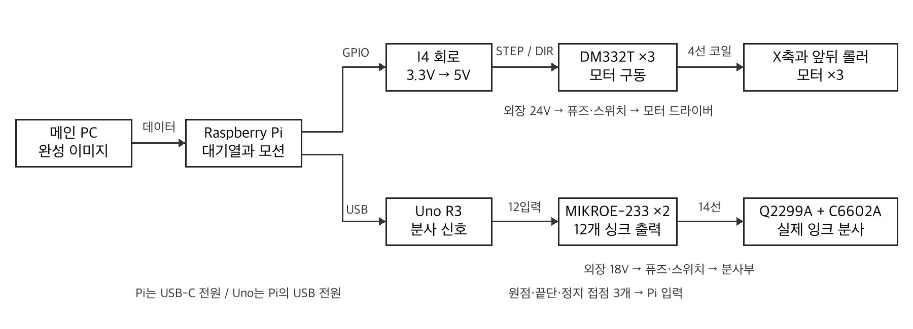

# 전시용 잉크젯 프린터 전기부 통합 제작 문의서

의뢰자 어준 · 2026년 10월 13일 · 1대분 · 검토 및 견적 요청

## 1 문의 내용

안녕하세요. 전시용 DIY 잉크젯 프린터의 전기부 제작을 문의드립니다. 주요 보드와 모터를 제가 구매해 전달하면, 추가 회로 제작부터 배선·제어함 조립·검사까지 한 업체에서 맡아 주셨으면 합니다. 귀사에서 일부 공정을 협력사에 맡기셔도 괜찮지만, 제게는 한 담당자가 전체 연결과 납품을 책임지는 방식으로 부탁드립니다.

납품받은 뒤 제가 할 일은 프레임에 완성품을 볼트로 고정하고, 번호가 표시된 케이블을 연결하는 정도로 생각하고 있습니다. 전선 절단·탈피·압착·납땜·핀 교체·절연 작업은 완료해서 받고 싶습니다. 용접은 요청하지 않습니다.

프린터는 검정 잉크 카트리지로 297mm 폭 롤지에 글리프를 한 행씩 인쇄합니다. 헤드가 좌우로 움직이고 앞뒤 롤러가 종이를 이동시키며, 종이는 자르지 않고 이어집니다. 기계 프레임과 3D 출력부품 조립은 제가 진행합니다.

요청하는 전기부는 Raspberry Pi와 Arduino Uno, 모터 드라이버 3개, 잉크 분사 보드 2개, 전원 어댑터와 스위치를 연결하는 구성입니다. 작은 신호변환 회로와 분사 기본 OFF 회로는 추가 제작이 필요합니다. 이 파일에 부품 목록, 핀별 연결 기준, 케이블과 검사 범위를 함께 담았습니다.

현재 자료로 검토와 견적이 가능한지, 제작에 필요한 회로도 보완까지 맡을 수 있는지 알려 주세요. 부품을 모두 받은 뒤 작업 기간과 반송 기간을 포함해 2026년 10월 말, 늦어도 11월 7일까지 국내 수령 가능한 일정인지 부탁드립니다.

이 자료는 제작 검토 기준입니다. 실제 부품의 접점 확인과 제작용 도면 승인을 거쳐 발주하려고 합니다. 이번 문의에 전시 웹사이트나 전체 프린터 응용 프로그램 개발은 포함하지 않습니다. 전기부 기능검사에 필요한 시험 신호나 간단한 시험 코드 준비는 견적에 구분해 주세요.

감사합니다. 어준 드림

## 2 전체 구성과 담당 범위

메인 PC에서 완성된 흑백 이미지를 보내고, 프린터용 Pi가 이미지 대기열과 모터 이동을 담당합니다. Pi와 USB로 연결된 Uno가 12개 잉크 분사 신호를 담당합니다. 프로그램의 역할을 설명한 것이며 현재 완성된 구동 소프트웨어가 있다는 뜻은 아닙니다.

| 구분 | 담당 작업 |
| --- | --- |
| 제가 준비 | 주요 보드·모터·카트리지·홀더·어댑터의 구매와 전달, 기계 프레임 및 급지부 조립 |
| 업체 전체 담당 | 추가 회로 제작, 소형 전자부품 조달, 내부 결선, 외부 케이블 제작, 제어함 가공·고정, 검사와 연결 안내 |
| 제가 수령 후 진행 | 완성 제어함과 헤드 연결부 고정, 표시대로 케이블 연결, 기계 높이·장력 조정과 전체 인쇄 시험 |

전원은 밀폐형 외장 어댑터를 사용합니다. 사용자가 220V 단자를 결선하는 구조를 원하지 않습니다. AC 코드는 기성 완성품을 그대로 사용하고, 제작 배선은 어댑터 이후의 저전압 구간입니다. 프레임 용접이나 금속 구조물 제작은 이 전기부 문의에서 제외합니다.

## 3 주요 부품과 업체 제작품

| 주요 부품 | 기준 모델 또는 옵션 | 수량 |
| --- | --- | --- |
| 프린터용 컴퓨터 | Raspberry Pi 4 Model B 4GB | 1 |
| Pi 전원과 저장장치 | 공식 27W USB-C 한국형 KO/KC 전원, microSD 32GB | 각 1 |
| 분사 제어 보드 | Arduino Uno R3 ATmega328P 5V 16MHz | 1 |
| Uno 단자 실드 | DFRobot DFR0224 | 1 |
| 분사 드라이버 | MikroElektronika MIKROE-233 | 2 |
| 카트리지 | HP C6602A 검정, 사용 1개와 밀봉 예비 1개 | 2 |
| 카트리지 홀더 | HP Q2299A, 16접점 리본 포함 기준 | 1 |
| 리본 변환보드 | 16P 1.0mm FFC/FPC, Straight-16P-1PCS 납땜형 | 1 |
| 모터 드라이버 | STEPPERONLINE DM332T | 3 |
| X축 모터 | Bulk-Man VS17B 500mm Silver 키트의 NEMA17 | 1 |
| 앞뒤 급지 모터 | STEPPERONLINE 17HS19-1684S1, 1.68A 상전류 | 2 |
| 모터 전원 | MEAN WELL GST120A24-P1M, 24V 5A | 1 |
| 헤드 전원 | MEAN WELL GST60A18-P1J, 18V 3.33A | 1 |
| 접점 스위치 | Panasonic AEQ10410, 원점·끝단·정지 요청 | 3 |
| 완성 코드 | 접지 C13 코드 2개, Pi와 Uno용 USB A B 데이터선 | 1식 |

위 목록은 현재 선정 기준입니다. 실제 구매·입고 여부는 전달 때 확인합니다. 기존 보유 Pi는 디스플레이용이므로 프린터용 Pi는 별도 준비합니다. Q2299A와 FFC는 실제 접점 대조를 위해 현물로 전달하고, 예비 카트리지는 밀봉 보관합니다.

업체 제작품은 3.3V에서 5V로 모터 신호를 전달하는 회로 1식, 분사 입력 12개의 기본 OFF 저항 회로 1식, 탈착식 시험 저항 부하 1식, DC 전원 분배·퓨즈·스위치 연결, 모든 내부·외부 배선과 제어함 조립입니다. 저항·IC·소켓·단자·전선 등 소부품은 업체에서 조달해 주세요.

기성 모듈과 모터의 동봉선을 가능한 범위에서 활용해 주세요. 추가 회로는 만능기판 또는 소형 PCB 중 단품 제작에 적합한 방법을 제안해 주세요. 현재 제조용 PCB 파일은 없습니다. 모델 변경이 필요하면 이유와 연결 변경을 먼저 알려 주세요.

## 4 Pi와 모터 신호 회로

기준 회로는 U3 SN74ACT244N DIP20과 U4 SN74AHCT14N DIP14입니다. Pi의 3.3V STEP DIR 신호 6개를 5V로 전달하고, ARM 신호가 준비 상태에서만 전달을 허용합니다. Pi 물리핀은 40핀 헤더 위치, BCM은 프로그램에서 쓰는 GPIO 번호입니다.

| 기능 | BCM | 물리핀 | U3 입력 | U3 출력 | DM332T 도착 |
| --- | --- | --- | --- | --- | --- |
| X STEP | 17 | 11 | 2 | 18 | X PUL |
| X DIR | 27 | 13 | 4 | 16 | X DIR |
| 뒤 급지 STEP | 22 | 15 | 6 | 14 | 뒤 PUL |
| 뒤 급지 DIR | 23 | 16 | 8 | 12 | 뒤 DIR |
| 앞 급지 STEP | 24 | 18 | 11 | 9 | 앞 PUL |
| 앞 급지 DIR | 25 | 22 | 13 | 7 | 앞 DIR |

각 Pi 신호와 U3 입력 사이에 330Ω을 직렬로 넣고, 그 뒤 U3 입력에서 GND로 10kΩ 풀다운을 둡니다. 각 U3 출력은 10kΩ으로 +5_I4에 풀업합니다. 출력끼리 묶지 않습니다. 업체에서 실제 드라이버 입력 전류와 U3의 채널별·패키지 합계 전류를 대조하고, 구동 여유가 부족하면 변경안을 알려 주세요.

| 지점 | 연결 기준 |
| --- | --- |
| Pi 물리핀 2 | 5V → MF-R050 분기 보호 → +5_I4 |
| +5_I4 | U3 pin20, U4 pin14, DM332T 3개 OPTO |
| Pi 물리핀 6 | 논리 GND → U3 pin10, U4 pin7, 회로 저항 GND |
| ARM BCM26 물리핀37 | 1kΩ 직렬 → U4 pin1, 입력에서 10kΩ → GND |
| U4 pin2 | U3 pin1과 pin19의 OE, 해당 지점 10kΩ → +5_I4 |
| 전원 안정화 | U3와 U4 각각 전원핀 근처 100nF, +5_I4와 GND 사이 10µF 16V |
| 미사용 입력 | U3 pin15와17, U4 pin3·5·9·11·13 → GND |
| 미사용 출력 | U3 pin3과5, U4 pin4·6·8·10·12 → 미연결 절연 |

정상 5V에서 ARM LOW는 전달 차단, ARM HIGH는 전달 허용입니다. STEP 대기는 HIGH로 두고, STEP와 DIR을 안정시킨 뒤 ARM을 허용해야 합니다. 전원 상승·하강 때의 불필요한 펄스는 실제 부하를 연결해 검사해 주세요. OE의 5V 지점을 Pi GPIO에 직접 연결하지 않습니다.

각 드라이버는 OPTO에 +5_I4, PUL과 DIR에 해당 출력만 연결하고 ENA는 현재 기준에서 비워 둡니다. ARM 차단은 펄스 전달 차단이며 모터 전원 차단은 아닙니다. Pi GND에서 모터 전원 GND로 추가 점퍼를 넣지 않고, 실제 전원·USB의 공통 경로는 측정해 기록해 주세요.

## 5 전원 분배와 접점 입력

24V와 18V의 양극을 서로 연결하지 않습니다. I4의 5V는 Pi에서만 공급합니다. 별도 5V 어댑터 또는 Uno 5V를 I4에 추가하지 않습니다.

| 전원 구간 | 연결 순서 또는 기준 |
| --- | --- |
| 모터 양극 | 24V 어댑터 → Tensility 10-02245 잭선 → 5A 퓨즈 → S1A 스위치 → 드라이버 3개 각각의 P2 +Vdc |
| 모터 음극 | 24V 어댑터 음극 → 별도 분배 → 드라이버 3개 P2 GND |
| 모터 코일 | 각 드라이버 A+ A− B+ B− → 해당 모터의 확인된 코일쌍 |
| 헤드 양극 | 18V 어댑터 → Tensility 10-02247 잭선 → 2A 퓨즈 → 별도 S1A 스위치 → +LOAD |
| 헤드 음극 | 18V 어댑터 음극 → Uno GND, 분사 보드 GND와 공통 기준 |
| 기본 분배 부품 | WAGO 221-413 합계 9개, 221-415 2개 기준. 퓨즈홀더 BK/HHC-R 2개 |
| 분리 표시 | 24V 모터 전원, 18V 헤드 전원을 스위치와 잭에 각각 표시 |

DC 잭 기준은 24V용 중심 양극 5.5×2.5mm, 18V용 중심 양극 5.5×2.1mm입니다. 스위치는 DC30V 20A S1A 기준이며 배선·절연을 완료해 주세요. 퓨즈는 실제 부하·선 굵기와 맞는지 확인합니다. 하나의 WAGO 안에는 같은 전기 지점만 넣습니다.

급지 모터는 1.68A 상전류입니다. 최초 무부하 설정은 DM332T 1.63A peak 1.16A RMS, SW1 ON SW2 OFF SW3 ON을 기준으로 검토합니다. X축 모터 설정은 현물 라벨과 코일 측정으로 정합니다. 최종 DIP 설정과 마이크로스텝 값을 납품 기록에 남겨 주세요.

| 접점 용도 | Pi BCM | 물리핀 | 배선 |
| --- | --- | --- | --- |
| 원점 | 5 | 29 | 입력 → 1kΩ → NC, COM → 논리 GND |
| 끝단 | 6 | 31 | 위와 동일 |
| 정지 요청 | 16 | 36 | 위와 동일 |

각 Pi 입력에서 Pi 3.3V 물리핀1로 10kΩ 풀업을 둡니다. NO는 비우고 절연합니다. 닫힌 상태 약 0.3V, 누름·단선으로 열렸을 때 약 3.3V를 목표로 검사합니다. GPIO에 5V나 24V를 넣지 않습니다. 스위치의 COM NC는 위치를 추정하지 않고 현물로 확인합니다.

접점 입력은 프로그램에서 처리해야 정지합니다. 이번 견적에서는 입력 측정과 시험 코드로 동작 확인까지 요청합니다. 정지 입력을 해제해도 자동 재개되지 않게 검사하고, 전원 차단을 대신하는 안전 인증 비상정지 장치로 표시하지 않습니다.

## 6 Uno와 잉크 분사 보드

MIKROE-233 두 개를 U1 U2로 표시합니다. 입력 HIGH가 해당 출력 전류를 GND로 당기는 구조입니다. 12개 사용 입력 각각에 10kΩ 풀다운을 둡니다. Uno 부팅·리셋·USB 재연결 중에는 분사 입력이 LOW인지 검사합니다.

| 채널 | Uno 핀 | 보드 | CN9 입력 | 싱크 출력 |
| --- | --- | --- | --- | --- |
| N0 | D2 | U1 | D0 | CN1 DRV0 |
| N1 | D3 | U1 | D1 | CN2 DRV1 |
| N2 | D4 | U1 | D2 | CN3 DRV2 |
| N3 | D5 | U1 | D3 | CN4 DRV3 |
| N4 | D6 | U1 | D4 | CN5 DRV4 |
| N5 | D7 | U1 | D5 | CN6 DRV5 |
| N6 | D8 | U1 | D6 | CN7 DRV6 |
| N7 | D9 | U1 | D7 | CN8 DRV7 |
| N8 | D10 | U2 | D0 | CN1 DRV0 |
| N9 | D11 | U2 | D1 | CN2 DRV1 |
| N10 | D12 | U2 | D2 | CN3 DRV2 |
| N11 | A1 | U2 | D3 | CN4 DRV3 |

Uno D0 D1은 USB 시리얼, D13은 부팅 LED와 관련되어 분사에 쓰지 않습니다. U2의 CN9 D4 D5 D6 D7은 GND로 고정하고 해당 미사용 출력은 각각 절연합니다. DFR0224의 단자 이름을 기준으로 배선하며, 입력 저항과 분기는 별도 작은 기판에서 정리합니다.

| 두 분사 보드의 공통 단자 | 연결 |
| --- | --- |
| CN10 VCC-EXT | +LOAD, 첫 시험은 5V 저항부하 이후 18V |
| CN10 GND와 CN9 GND | 부하 음극과 Uno 논리 GND |
| J1 | VCC-EXT 쪽 선택 |
| CN9 VCC | 연결하지 않고 절연 |
| CN1부터 CN8 VCC-DRIVE | 부하 양극, 싱크 출력과 구분 |
| CN1부터 CN8 DRV | 각 노즐 반환선 또는 시험 저항 |

수령 보드의 ULN2803 계열 IC, E1 콘덴서 25V 이상 여부와 실제 단자를 공개 회로와 대조해 주세요. 다른 회로가 납품되면 부품 하나를 임의 교체해 진행하지 않고 알려 주세요. 단자 이름과 도통으로 대응하며 사진의 좌우를 핀 번호로 가정하지 않습니다.

## 7 헤드 리본 접점 대조

아래 RC는 원작 Figure 9 그림에서 리본 끝이 왼쪽, 케이블이 오른쪽으로 뻗을 때 위에서 아래로 붙인 위치 이름입니다. HP 공식 핀 번호 또는 실제 변환보드 번호가 아닙니다. 표의 마지막 칸은 업체가 현물 검사 후 작성할 항목입니다.

| 참조 위치 | 연결 기준 | 실제 FFC 보드 패드 |
| --- | --- | --- |
| RC01 | 미사용, 절연 | 현물 확인 |
| RC02 | 미사용, 절연 | 현물 확인 |
| RC03 | +LOAD 공통 전원 | 현물 확인 |
| RC04 | N11, U2 CN4 DRV3 | 현물 확인 |
| RC05 | N10, U2 CN3 DRV2 | 현물 확인 |
| RC06 | N9, U2 CN2 DRV1 | 현물 확인 |
| RC07 | N8, U2 CN1 DRV0 | 현물 확인 |
| RC08 | N7, U1 CN8 DRV7 | 현물 확인 |
| RC09 | N6, U1 CN7 DRV6 | 현물 확인 |
| RC10 | N5, U1 CN6 DRV5 | 현물 확인 |
| RC11 | N4, U1 CN5 DRV4 | 현물 확인 |
| RC12 | N3, U1 CN4 DRV3 | 현물 확인 |
| RC13 | N2, U1 CN3 DRV2 | 현물 확인 |
| RC14 | N1, U1 CN2 DRV1 | 현물 확인 |
| RC15 | N0, U1 CN1 DRV0 | 현물 확인 |
| RC16 | +LOAD 공통 전원 | 현물 확인 |

빈 홀더에서 Q2299A 접점 → 리본 → 변환보드 패드까지 16개 모두 도통을 확인하고 방향 사진을 남겨 주세요. 의도된 공통 연결과 인접 단락을 구분합니다. 카트리지를 끼운 상태의 저항 경로로 빈 홀더 검사를 대신하지 않습니다.

FFC 기준은 16핀 1.0mm입니다. 실제 소켓의 접점 면·허용 리본 두께·접점 전류·전압 정격과 삽입 잠금을 대조해 주세요. 사급 범용 보드가 부적합하면 적합한 변환부와 연결법을 제안하고 승인을 받은 뒤 진행합니다. 두 공통 전원 접점에 전류가 균등 분담된다고 가정하지 않습니다.

실물 패드 번호와 노즐의 물리적 배열 순서는 아직 확인하지 않았습니다. RC 참조표만으로 실제 헤드를 통전하지 않습니다. 현물 접점표가 작성된 후 헤드 하네스 최종 결선을 승인하려고 합니다.

## 8 케이블과 완성 조립품 납품

| 연결 묶음 | 수량 | 납품 기준 |
| --- | --- | --- |
| Pi에서 I4 신호와 전원 | 1식 | GPIO 물리핀 번호와 양끝 표시, Pi 근처 고정 |
| I4에서 DM332T 제어 | 3조 | X 뒤 급지 앞 급지 구분, 각 OPTO PUL DIR |
| 드라이버에서 모터 | 3조 | 각 4선 코일 대응, 동봉선 활용과 끝처리 |
| 원점 끝단 정지 입력 | 3조 | 각 COM NC와 용도 라벨, NO 절연 |
| 24V 및 18V 전원 배선 | 각 1식 | 잭·퓨즈·스위치·분배 연결 완료, 전압 구분 |
| Uno에서 분사 보드 | 1식 | 12입력과 풀다운·논리 GND 연결 완료 |
| 움직이는 헤드 배선 | 1조 | 12반환선과 공통 전원선2, 합계14가닥 |
| Pi에서 Uno USB | 1개 | 기성 데이터 케이블 유지 |

견적용 길이는 가동 헤드선 약 1m, 센서선 각각 0.9m 이내, 드라이버 전원 분기선 각각 0.5m 이내입니다. 최종 재단 길이는 기계 배치와 양끝 커넥터를 확인한 뒤 정해 주세요. 움직이는 헤드선은 유연한 22AWG 실리콘선, 고정 전원선은 18AWG를 기준으로 검토합니다. 실제 단자 정격·전압강하·굴곡과 파형에 맞춰 확정합니다.

케이블의 양끝은 커넥터 또는 해당 단자에 맞는 처리된 끝단으로 받습니다. 잠금·당김 방지·절연·번호 라벨을 포함하고, 제가 전선을 가공해야 연결되는 상태는 피하고 싶습니다. 커넥터 모델·핀 순서·굵기·최종 길이는 업체에서 선정해 승인받아 주세요.

납품 형태는 결선된 제어함 1식, 고정 가능한 헤드 연결부 1식, 표시된 외부 케이블과 접점 스위치 3개입니다. 제어함의 보드 고정·케이블 구멍·통풍·노출 단자 보호를 완료해 주세요. 기존 후보는 화신 EG-AGH304016이지만 내부 배치가 아직 확정되지 않아 업체 권장 규격을 검토할 수 있습니다.

함 밖에는 외장 어댑터와 모터·헤드·스위치 연결만 남기고, 24V와 18V 수동 스위치를 사용하기 쉬운 위치에 표시해 주세요. 열이 나는 드라이버·저항의 간격과 통풍을 확보합니다. 기판 조립, 배선, 검사 담당을 업체 내부에서 통합해 주세요.

함께 받고 싶은 자료는 최종 회로도와 핀별 연결표, 커넥터 사진·번호 안내, 실제 소부품 명세, 설정값, 검사 결과와 측정 사진입니다. 제가 읽을 연결 안내는 고정 위치 → 전원 코드 → 번호별 케이블 → 첫 전원 순서로 간단히 부탁드립니다.

## 9 검사 범위와 견적 회신

| 순서 | 요청하는 확인 | 받을 기록 |
| --- | --- | --- |
| 1 무전원 | 현물 모델, 극성, 단락, 모터 코일, FFC 접점 대조 | 연결표와 방향 사진 |
| 2 논리 전원 | Pi I4 신호 레벨, ARM 차단, 스위치 입력 | 실제 LOW HIGH 전압 |
| 3 모터 시험 | 실제 DM332T 부하의 신호와 헤드 OFF 저속 왕복, 원점·끝단·정지 입력 | DIP 설정, 펄스·방향·입력 동작 |
| 4 5V 저항 부하 | Uno 분사 입력, 부팅·리셋·USB 재연결의 기본 OFF | 채널 대응과 신호 파형 |
| 5 18V 저항 부하 | 실제 가동선 길이로 출력 전압·펄스·정지 상태 검사 | 오실로스코프 측정 사진 |
| 6 현물 헤드 단발 | 위 검사를 통과한 뒤 협의하여 한 노즐부터 짧게 분사 | 수행 여부와 결과, 비용 구분 |

헤드 대체 시험 부하는 150Ω 3W 저항 2개 병렬의 75Ω을 한 채널에 사용합니다. 검사 중 헤드와 FFC는 분리합니다. 5V 부하 시험을 마친 뒤 전원을 끄고 5V 부하 연결을 제거한 다음 18V로 바꿉니다. 저항 부하는 실제 카트리지 내부 특성을 보증하지 않습니다.

기본 참조는 HomoFaciens C6602 실험의 18V와 약 3µs입니다. HP 보증 구동값으로 취급하지 않고 실제 보드·케이블의 파형을 확인합니다. 전원 18V에 연결된 상태에서 긴 HIGH나 지속 분사가 생기지 않아야 합니다. 10kΩ 풀다운만으로 프로그램 출력 고착을 막을 수는 없습니다.

신호 상실·출력 고착 때 분사를 차단하고, 정지 요청 때 이동과 분사를 멈추는 방법도 검토해 주세요. 추가 보호 회로 또는 코드가 필요하면 기능·부품·금액을 구분해 제안해 주세요. 현재 ARM은 모터 전원 차단이 아니며 전시 무인 운영 보호가 완성된 상태는 아닙니다.

검사용 신호 발생기 또는 간단한 시험 코드는 업체 준비 가능 여부와 비용을 알려 주세요. 메인 전시 프로그램과 전체 인쇄 펌웨어는 제가 이후 진행하므로, 별도 신호 준비가 필요한 항목은 견적 단계에서 합의하고 싶습니다. 도통·외관 검사만 가능한 경우 기능검사 가능 범위를 구분해 주세요.

회신에는 1대분 통합 제작 가능 여부, 사급 수락과 필요한 현물, 도면 보완·소부품·조립·케이블·제어함·시험 코드·검사별 금액과 VAT, 부품 입고 마감일·작업일·반송일, 납품 자료, 초기불량·시험손상 처리 조건을 부탁드립니다. 추가 금액이나 모델 변경은 작업 전에 승인받아 주세요.

## 10 참고 회로와 제작 검토 자료

이 파일의 연결표는 기존 설계 기준을 통합한 것입니다. 상세 이력은 저장소 printer 폴더의 I4 WIRING, MOTOR POWER, HEAD TEST, HEAD CONTACT, G4 INPUTS 문서에 있습니다. 최초 검토에 여러 파일을 따로 열 필요가 없도록 연결 기준을 이 파일에 실었습니다.

원작 헤드 Figure 9와 실험값: https://homofaciens.de/technics-machines-printhead-hp6602_en.htm

분사 보드 제조사 회로도: https://download.mikroe.com/documents/add-on-boards/other/power-supply/mikrodrive/mikrodrive-manual-v100.pdf

분사 보드 제품: https://www.mikroe.com/mikrodrive-board

DM332T 설명서: https://www.omc-stepperonline.com/download/DM332T_user_manual.pdf

SN74ACT244 자료: https://www.ti.com/lit/ds/symlink/sn74act244.pdf

SN74AHCT14 자료: https://www.ti.com/lit/ds/symlink/sn74ahct14.pdf

프로젝트 저장소: https://github.com/nujoe/cstm_printer_CA_glyph

실물 검사 전 비어 있는 부분은 FFC 패드 번호, X축 모터 전류 설정, 최종 케이블 커넥터·길이와 제어함 배치입니다. 이 부분의 확인과 제작용 도면 정리를 함께 요청합니다. 수락 범위와 견적을 받은 뒤 부품 전달 및 제작 승인을 진행하려고 합니다.
