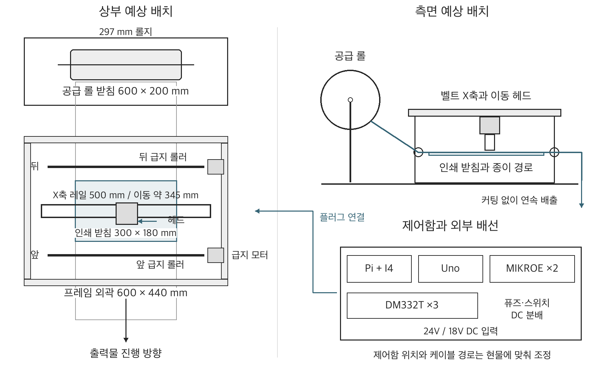

# 전시용 잉크젯 프린터 전기부 통합 제작 문의서

의뢰자 어준 · 2026년 10월 13일 · 1대분 · 검토 및 견적 요청

## 1 문의 내용

안녕하세요. 어준입니다. 전시용 잉크젯 프린터 1대의 전기부 제작과 조립을 문의드립니다. 주요 부품을 제공하는 조건으로, 추가 회로 제작·제어함 조립·케이블 제작 및 최종 연결·기능검사까지 일괄 의뢰드리고자 합니다.

제어함 내부 배선과 모터·헤드·접점 스위치·전원 배선은 양끝 결선과 나사단자 체결까지 완료하여 부탁드립니다. 기계 조립이나 운송 때문에 분리가 필요한 구간은 번호별 플러그만 연결하면 되는 형태로 요청드립니다. 전선 가공이나 나사단자 결선이 남지 않도록 케이블 제작·절연·전기적 확인까지 포함한 견적을 부탁드립니다.

프린터는 검정 잉크 카트리지로 297mm 폭 롤지에 글리프를 한 행씩 인쇄하는 장치입니다. 헤드가 좌우로 움직이고 앞뒤 롤러가 종이를 이동시키며, 종이는 자르지 않고 연속으로 출력합니다.

Raspberry Pi와 Arduino Uno, 모터 드라이버 3개, 잉크 분사 보드 2개를 연결하는 구성입니다. 신호변환 회로와 분사 입력의 기본 OFF 회로는 추가 제작이 필요합니다. 검토에 참고하실 수 있도록 예상 배치도, 부품 목록, 핀별 연결 기준과 검사 항목을 첨부하였습니다.

첨부 자료를 기준으로 제작 가능 여부와 예상 비용을 안내해 주시면 감사하겠습니다. 제작용 회로도 보완과 실제 부품의 접점 확인도 함께 요청드립니다. 희망 수령일은 2026년 10월 말이며, 늦어도 11월 7일까지 수령 가능한 일정인지 검토 부탁드립니다.

견적은 전기부 제작·최종 결선과 벤치 기능검사를 기준으로 부탁드립니다. 검사용 신호와 코드 준비부터 실행·계측·전기적 고장 진단·보완 후 재검사까지 맡아 주실 수 있는지 검토 부탁드립니다. 별도의 전기 검사나 고장 진단을 진행하지 않아도 되는 납품 범위인지, 가능한 검사 항목과 비용을 함께 안내해 주시면 감사하겠습니다.

감사합니다. 어준 드림

## 2 전체 구성과 담당 범위

메인 PC에서 완성된 흑백 이미지를 전송하면 Pi에서 이미지 대기열과 모터 이동을 처리하고, USB로 연결된 Uno에서 12개 잉크 분사 신호를 출력하는 구성입니다.

| 의뢰 범위 | 요청 내용 |
| --- | --- |
| 회로와 제어함 | 추가 회로 제작, 소형 전자부품 조달, 보드 고정, 전원 분배와 내부 결선 |
| 외부 배선과 최종 연결 | 케이블 양끝 결선·나사단자 체결·절연 완료, 분리 구간 번호별 플러그, 배선 식별과 고정 |
| 벤치 전기 검사 | 시험 신호·코드 준비, 실행·계측·전기적 고장 진단과 보완 후 재검사 |
| 납품 자료 | 최종 연결표, 설정값, 검사 결과, 플러그 연결과 전원 사용 안내 |

전원은 밀폐형 외장 어댑터와 기성 AC 코드를 사용합니다. 제작 배선은 어댑터 이후의 DC 전원과 제어 신호 구간을 기준으로 부탁드립니다.

## 3 장치 예상 배치도

프레임 외곽은 600×440mm, 인쇄 받침판은 300×180mm, 공급 롤 받침판은 600×200mm를 기준으로 합니다. X축 레일 길이는 500mm이며 유효 이동거리는 약 345mm입니다. 용지 폭은 297mm, 목표 인쇄 폭은 약 270mm입니다.

이 배치도는 장치 배치와 배선 길이 검토용입니다. 제어함 위치, 케이블 길이와 가동 여유를 검토하시어 연결 사양 확정을 부탁드립니다. 외부 케이블도 양끝 결선과 나사단자 체결을 완료하고, 기계 조립을 위해 분리되는 구간은 번호별 플러그로 구성해 주시기 바랍니다.

이번 검사 범위는 프레임 장착 전 모터·스위치·분사부의 벤치 전기 시험입니다. 실제 캐리지 이동, 원점·끝단 위치 조정, 급지와 인쇄 상태 확인은 기계 조립 후 별도 시험으로 구분하여 부탁드립니다.

## 4 주요 부품과 추가 제작품

| 주요 부품 | 기준 모델 또는 옵션 | 수량 |
| --- | --- | --- |
| 프린터용 컴퓨터 | Raspberry Pi 4 Model B 4GB | 1 |
| Pi 전원과 저장장치 | 공식 27W USB-C 한국형 KO/KC 전원, microSD 32GB | 각 1 |
| 분사 제어 보드 | Arduino Uno R3 ATmega328P 5V 16MHz | 1 |
| Uno 단자 실드 | DFRobot DFR0224 | 1 |
| 분사 드라이버 | MikroElektronika MIKROE-233 | 2 |
| 카트리지 | HP C6602A 검정, 사용 1개와 밀봉 예비 1개 | 2 |
| 카트리지 홀더 | HP Q2299A, 16접점 리본 포함 기준 | 1 |
| 리본 변환보드 | 16P 1.0mm FFC/FPC, Straight-16P-1PCS 납땜형 | 1 |
| 모터 드라이버 | STEPPERONLINE DM332T | 3 |
| X축 모터 | Bulk-Man VS17B 500mm Silver 키트의 NEMA17 | 1 |
| 앞뒤 급지 모터 | STEPPERONLINE 17HS19-1684S1, 1.68A 상전류 | 2 |
| 모터 전원 | MEAN WELL GST120A24-P1M, 24V 5A | 1 |
| 헤드 전원 | MEAN WELL GST60A18-P1J, 18V 3.33A | 1 |
| 접점 스위치 | Panasonic AEQ10410, 원점·끝단·정지 요청 | 3 |
| 완성 코드 | 접지 C13 코드 2개, Pi와 Uno용 USB A B 데이터선 | 1식 |

추가 제작품은 3.3V에서 5V로 모터 신호를 전달하는 회로 1식, 분사 입력 12개의 기본 OFF 저항 회로 1식, 탈착식 시험 저항 부하 1식입니다. DC 전원 분배·퓨즈·스위치 연결과 모든 내부·외부 배선, 제어함 조립도 포함하여 부탁드립니다. 저항·IC·소켓·단자·전선 등 소부품은 조달 비용을 견적에 포함해 주시기 바랍니다.

기성 모듈과 모터의 동봉선을 활용할 수 있는 경우 활용을 부탁드립니다. 추가 회로는 만능기판 또는 소형 PCB 중 단품 제작에 적합한 방법으로 제안해 주시면 감사하겠습니다. 제작용 회로도와 PCB 설계가 필요한 경우 해당 비용을 구분해 주시기 바랍니다. 부품 변경이 필요한 경우 변경 사유와 적용 구성을 안내 부탁드립니다.

## 5 Pi와 모터 신호 회로

기준 회로는 U3 SN74ACT244N DIP20과 U4 SN74AHCT14N DIP14입니다. Pi의 3.3V STEP DIR 신호 6개를 5V로 전달하고, ARM 신호가 준비 상태에서만 전달을 허용합니다. Pi 물리핀은 40핀 헤더 위치, BCM은 프로그램에서 쓰는 GPIO 번호입니다.

| 기능 | BCM | 물리핀 | U3 입력 | U3 출력 | DM332T 도착 |
| --- | --- | --- | --- | --- | --- |
| X STEP | 17 | 11 | 2 | 18 | X PUL |
| X DIR | 27 | 13 | 4 | 16 | X DIR |
| 뒤 급지 STEP | 22 | 15 | 6 | 14 | 뒤 PUL |
| 뒤 급지 DIR | 23 | 16 | 8 | 12 | 뒤 DIR |
| 앞 급지 STEP | 24 | 18 | 11 | 9 | 앞 PUL |
| 앞 급지 DIR | 25 | 22 | 13 | 7 | 앞 DIR |

각 Pi 신호와 U3 입력 사이에 330Ω을 직렬로 넣고, 그 뒤 U3 입력에서 GND로 10kΩ 풀다운을 둡니다. 각 U3 출력은 10kΩ으로 +5_I4에 풀업하며 출력끼리 묶지 않습니다. 실제 드라이버 입력 전류와 U3의 채널별·패키지 합계 전류를 대조하여 구동 여유가 부족한 경우 변경안 검토를 부탁드립니다.

| 지점 | 연결 기준 |
| --- | --- |
| Pi 물리핀 2 | 5V → MF-R050 분기 보호 → +5_I4 |
| +5_I4 | U3 pin20, U4 pin14, DM332T 3개 OPTO |
| Pi 물리핀 6 | 논리 GND → U3 pin10, U4 pin7, 회로 저항 GND |
| ARM BCM26 물리핀37 | 1kΩ 직렬 → U4 pin1, 입력에서 10kΩ → GND |
| U4 pin2 | U3 pin1과 pin19의 OE, 해당 지점 10kΩ → +5_I4 |
| 전원 안정화 | U3와 U4 각각 전원핀 근처 100nF, +5_I4와 GND 사이 10µF 16V |
| 미사용 입력 | U3 pin15와17, U4 pin3·5·9·11·13 → GND |
| 미사용 출력 | U3 pin3과5, U4 pin4·6·8·10·12 → 미연결 절연 |

정상 5V에서 ARM LOW는 전달 차단, ARM HIGH는 전달 허용입니다. STEP 대기는 HIGH로 두고, STEP와 DIR을 안정시킨 뒤 ARM을 허용해야 합니다. 전원 상승·하강 때 불필요한 펄스가 발생하지 않는지 실제 부하 검사도 부탁드립니다. OE의 5V 지점은 Pi GPIO와 직접 연결하지 않습니다.

각 드라이버는 OPTO에 +5_I4, PUL과 DIR에 해당 출력만 연결하고 ENA는 비워 둡니다. ARM 차단은 펄스 전달 차단이며 모터 전원 차단은 아닙니다. Pi GND에서 모터 전원 GND로 추가 점퍼를 넣지 않는 구성으로, 실제 전원·USB의 공통 경로 측정과 기록을 부탁드립니다.

## 6 전원 분배와 접점 입력

24V와 18V의 양극을 서로 연결하지 않습니다. I4의 5V는 Pi에서만 공급합니다. 별도 5V 어댑터 또는 Uno 5V를 I4에 추가하지 않습니다.

| 전원 구간 | 연결 순서 또는 기준 |
| --- | --- |
| 모터 양극 | 24V 어댑터 → Tensility 10-02245 잭선 → 5A 퓨즈 → S1A 스위치 → 드라이버 3개 각각의 P2 +Vdc |
| 모터 음극 | 24V 어댑터 음극 → 별도 분배 → 드라이버 3개 P2 GND |
| 모터 코일 | 각 드라이버 A+ A− B+ B− → 해당 모터의 확인된 코일쌍 |
| 헤드 양극 | 18V 어댑터 → Tensility 10-02247 잭선 → 2A 퓨즈 → 별도 S1A 스위치 → +LOAD |
| 헤드 음극 | 18V 어댑터 음극 → Uno GND, 분사 보드 GND와 공통 기준 |
| 기본 분배 부품 | WAGO 221-413 합계 9개, 221-415 2개 기준. 퓨즈홀더 BK/HHC-R 2개 |
| 분리 표시 | 24V 모터 전원, 18V 헤드 전원을 스위치와 잭에 각각 표시 |

DC 잭 기준은 24V용 중심 양극 5.5×2.5mm, 18V용 중심 양극 5.5×2.1mm입니다. 스위치는 DC30V 20A S1A 기준이며 배선·절연까지 완료하여 부탁드립니다. 퓨즈는 실제 부하·선 굵기에 적합한지 확인하고, 하나의 WAGO 안에는 같은 전기 지점만 연결합니다.

급지 모터는 1.68A 상전류입니다. 최초 무부하 설정은 DM332T 1.63A peak 1.16A RMS, SW1 ON SW2 OFF SW3 ON을 기준으로 검토 부탁드립니다. X축 모터 설정은 현물 라벨과 코일 측정을 기준으로 하며, 최종 DIP 설정과 마이크로스텝 값을 납품 자료에 포함해 주시기 바랍니다.

| 접점 용도 | Pi BCM | 물리핀 | 배선 |
| --- | --- | --- | --- |
| 원점 | 5 | 29 | 입력 → 1kΩ → NC, COM → 논리 GND |
| 끝단 | 6 | 31 | 위와 동일 |
| 정지 요청 | 16 | 36 | 위와 동일 |

각 Pi 입력에서 Pi 3.3V 물리핀1로 10kΩ 풀업을 둡니다. NO는 비우고 절연합니다. 닫힌 상태 약 0.3V, 누름·단선으로 열렸을 때 약 3.3V를 목표로 검사합니다. GPIO에 5V나 24V를 넣지 않습니다. 스위치의 COM NC는 위치를 추정하지 않고 현물로 확인합니다.

접점 입력은 프로그램에서 처리해야 정지하므로 입력 측정과 시험 코드에 의한 동작 확인까지 부탁드립니다. 벤치에서 각 스위치를 눌렀을 때와 해제·단선 상태의 입력을 확인하고, 정지 요청 해제만으로 모터 펄스가 자동 재개되지 않는 조건으로 검사를 요청드립니다. 해당 접점 입력은 전원 차단용 비상정지 장치와 구분합니다.

## 7 Uno와 잉크 분사 보드

MIKROE-233 두 개를 U1 U2로 표시합니다. 입력 HIGH가 해당 출력 전류를 GND로 당기는 구조입니다. 12개 사용 입력 각각에 10kΩ 풀다운을 둡니다. Uno 부팅·리셋·USB 재연결 중에는 분사 입력이 LOW인지 검사합니다.

| 채널 | Uno 핀 | 보드 | CN9 입력 | 싱크 출력 |
| --- | --- | --- | --- | --- |
| N0 | D2 | U1 | D0 | CN1 DRV0 |
| N1 | D3 | U1 | D1 | CN2 DRV1 |
| N2 | D4 | U1 | D2 | CN3 DRV2 |
| N3 | D5 | U1 | D3 | CN4 DRV3 |
| N4 | D6 | U1 | D4 | CN5 DRV4 |
| N5 | D7 | U1 | D5 | CN6 DRV5 |
| N6 | D8 | U1 | D6 | CN7 DRV6 |
| N7 | D9 | U1 | D7 | CN8 DRV7 |
| N8 | D10 | U2 | D0 | CN1 DRV0 |
| N9 | D11 | U2 | D1 | CN2 DRV1 |
| N10 | D12 | U2 | D2 | CN3 DRV2 |
| N11 | A1 | U2 | D3 | CN4 DRV3 |

Uno D0 D1은 USB 시리얼, D13은 부팅 LED와 관련되어 분사에 쓰지 않습니다. U2의 CN9 D4 D5 D6 D7은 GND로 고정하고 해당 미사용 출력은 각각 절연합니다. DFR0224의 단자 이름을 기준으로 배선하며, 입력 저항과 분기는 별도 작은 기판에서 정리합니다.

| 두 분사 보드의 공통 단자 | 연결 |
| --- | --- |
| CN10 VCC-EXT | +LOAD, 첫 시험은 5V 저항부하 이후 18V |
| CN10 GND와 CN9 GND | 부하 음극과 Uno 논리 GND |
| J1 | VCC-EXT 쪽 선택 |
| CN9 VCC | 연결하지 않고 절연 |
| CN1부터 CN8 VCC-DRIVE | 부하 양극, 싱크 출력과 구분 |
| CN1부터 CN8 DRV | 각 노즐 반환선 또는 시험 저항 |

수령 보드의 ULN2803 계열 IC, E1 콘덴서 25V 이상 여부와 실제 단자를 제조사 회로와 대조 부탁드립니다. 사양 차이가 있는 경우 적용 가능 여부와 변경안을 안내해 주시기 바랍니다. 단자 이름과 도통 측정을 기준으로 대응을 확인합니다.

## 8 헤드 리본 접점 대조

아래 RC는 참고 회로 Figure 9에서 리본 끝이 왼쪽, 케이블이 오른쪽으로 뻗을 때 위에서 아래로 붙인 위치 이름입니다. HP 공식 핀 번호나 실제 변환보드 번호와는 구분하며, 마지막 칸은 현물 대조 후 기입을 부탁드립니다.

| 참조 위치 | 연결 기준 | 실제 FFC 보드 패드 |
| --- | --- | --- |
| RC01 | 미사용, 절연 | 현물 확인 |
| RC02 | 미사용, 절연 | 현물 확인 |
| RC03 | +LOAD 공통 전원 | 현물 확인 |
| RC04 | N11, U2 CN4 DRV3 | 현물 확인 |
| RC05 | N10, U2 CN3 DRV2 | 현물 확인 |
| RC06 | N9, U2 CN2 DRV1 | 현물 확인 |
| RC07 | N8, U2 CN1 DRV0 | 현물 확인 |
| RC08 | N7, U1 CN8 DRV7 | 현물 확인 |
| RC09 | N6, U1 CN7 DRV6 | 현물 확인 |
| RC10 | N5, U1 CN6 DRV5 | 현물 확인 |
| RC11 | N4, U1 CN5 DRV4 | 현물 확인 |
| RC12 | N3, U1 CN4 DRV3 | 현물 확인 |
| RC13 | N2, U1 CN3 DRV2 | 현물 확인 |
| RC14 | N1, U1 CN2 DRV1 | 현물 확인 |
| RC15 | N0, U1 CN1 DRV0 | 현물 확인 |
| RC16 | +LOAD 공통 전원 | 현물 확인 |

카트리지를 분리한 빈 홀더에서 Q2299A 접점 → 리본 → 변환보드 패드까지 16개 접점의 도통을 확인하고 방향 사진을 남겨 주시기 바랍니다. 의도된 공통 연결과 인접 단락을 구분하여 확인 부탁드립니다.

FFC 기준은 16핀 1.0mm입니다. 실제 소켓의 접점 면·허용 리본 두께·접점 전류·전압 정격과 삽입 잠금을 대조 부탁드립니다. 제공한 변환보드가 적합하지 않은 경우 호환되는 변환부와 연결 방식을 제안해 주시면 감사하겠습니다. 공통 전원 접점의 전류 분담도 확인 항목에 포함해 주시기 바랍니다.

실제 변환보드 패드 번호와 노즐 배열은 현물 대조가 필요한 항목입니다. 확인된 접점표를 기준으로 헤드 배선 최종 연결과 검사를 부탁드립니다.

## 9 케이블 최종 연결과 납품

| 연결 묶음 | 수량 | 납품 기준 |
| --- | --- | --- |
| Pi에서 I4 신호와 전원 | 1식 | GPIO 물리핀 번호와 양끝 표시, Pi 근처 고정 |
| I4에서 DM332T 제어 | 3조 | X 뒤 급지 앞 급지 구분, 각 OPTO PUL DIR |
| 드라이버에서 모터 | 3조 | 각 4선 코일 대응, 동봉선 활용과 끝처리 |
| 원점 끝단 정지 입력 | 3조 | 각 COM NC와 용도 라벨, NO 절연 |
| 24V 및 18V 전원 배선 | 각 1식 | 잭·퓨즈·스위치·분배 연결 완료, 전압 구분 |
| Uno에서 분사 보드 | 1식 | 12입력과 풀다운·논리 GND 연결 완료 |
| 움직이는 헤드 배선 | 1조 | 12반환선과 공통 전원선2, 합계14가닥 |
| Pi에서 Uno USB | 1개 | 기성 데이터 케이블 유지 |

견적용 길이는 가동 헤드선 약 1m, 센서선 각각 0.9m 이내, 드라이버 전원 분기선 각각 0.5m 이내입니다. 예상 배치도와 가동 범위를 참고하여 최종 길이와 여유분 검토를 부탁드립니다. 움직이는 헤드선은 유연한 22AWG 실리콘선, 고정 전원선은 18AWG를 기준으로 실제 단자 정격·전압강하·굴곡과 파형에 맞게 검토 부탁드립니다.

케이블은 양끝 결선과 나사단자 체결, 절연·잠금·당김 방지를 모두 완료하여 부탁드립니다. 분리 구간은 번호별 플러그 연결만으로 사용할 수 있는 형태로 요청드립니다. 가공된 전선 끝을 별도로 체결해야 하는 상태는 납품 범위에 포함하지 않으며, 커넥터 모델·핀 순서·선 굵기·최종 길이는 제작 도면과 납품 자료에 기록 부탁드립니다.

납품 범위는 결선된 제어함과 모터·헤드·접점 스위치·전원 연결부를 포함한 전기부 전체입니다. 제어함의 보드 고정·케이블 구멍·통풍·노출 단자 보호와 연결부 고정을 완료하여 부탁드립니다. 제어함은 화신 EG-AGH304016을 참고 규격으로 검토하고 있으며, 내부 배치에 적합한 규격이 있는 경우 제안 부탁드립니다.

24V와 18V 수동 스위치는 용도를 표시하여 사용하기 쉬운 위치에 배치 부탁드립니다. 열이 나는 드라이버·저항의 간격과 통풍, 케이블 연결부의 당김 방지를 확보해 주시기 바랍니다. 분리 구간은 양쪽에 같은 번호와 연결 방향을 표시하고 플러그 사진을 포함한 안내를 요청드립니다.

최종 회로도와 핀별 연결표, 커넥터 사진, 실제 소부품 명세, 설정값, 검사 결과와 측정 사진을 함께 전달 부탁드립니다. 전원 투입·종료 순서와 기본 점검 방법도 간단한 사용 안내로 포함해 주시면 감사하겠습니다.

## 10 검사 범위와 견적 회신

| 순서 | 요청하는 확인 | 받을 기록 |
| --- | --- | --- |
| 1 무전원 | 현물 모델, 극성, 단락, 모터 코일, FFC 접점 대조 | 연결표와 방향 사진 |
| 2 논리 전원 | Pi I4 신호 레벨, ARM 차단, 스위치 입력 | 실제 LOW HIGH 전압 |
| 3 모터와 스위치 벤치 시험 | 프레임 장착 전 모터별 저속 정역회전, 스위치 누름·해제·단선 입력, 정지 요청 처리 | DIP 설정, 펄스·방향·입력 동작 |
| 4 5V 저항 부하 | Uno 분사 입력, 부팅·리셋·USB 재연결의 기본 OFF | 채널 대응과 신호 파형 |
| 5 18V 저항 부하 | 실제 가동선 길이로 출력 전압·펄스·정지 상태 검사 | 오실로스코프 측정 사진 |
| 6 현물 헤드 단발 | 위 검사를 통과한 뒤 협의하여 한 노즐부터 짧게 분사 | 수행 여부와 결과, 비용 구분 |

헤드 대체 시험 부하는 150Ω 3W 저항 2개 병렬의 75Ω을 한 채널에 사용합니다. 검사 중 헤드와 FFC는 분리합니다. 5V 부하 시험을 마친 뒤 전원을 끄고 5V 부하 연결을 제거한 다음 18V로 바꿉니다. 저항 부하는 실제 카트리지 내부 특성을 보증하지 않습니다.

기본 참조는 HomoFaciens C6602 실험의 18V와 약 3µs입니다. HP 보증 구동값으로 취급하지 않고 실제 보드·케이블의 파형을 확인합니다. 전원 18V에 연결된 상태에서 긴 HIGH나 지속 분사가 생기지 않아야 합니다. 10kΩ 풀다운만으로 프로그램 출력 고착을 막을 수는 없습니다.

신호 상실·출력 고착 때 분사를 차단하고, 정지 요청 때 이동과 분사를 멈추는 방식도 검토 부탁드립니다. 추가 보호 회로 또는 코드가 필요한 경우 기능·부품·비용을 구분하여 제안해 주시기 바랍니다. ARM은 펄스 전달 차단이므로 전원 차단과 구분하여 검토 부탁드립니다.

검사용 신호·코드 준비, 시험 실행, 오실로스코프 계측과 전기적 고장 진단까지 일괄 수행 가능한지 안내 부탁드립니다. 검사 불합격 항목의 원인 확인·보완·재검사도 포함하여 요청드립니다. 납품 후 별도의 전기 계측이나 고장 진단 없이 번호별 플러그 연결과 전원 사용이 가능한 범위인지, 미포함 항목이 있다면 회신에 명시해 주시면 감사하겠습니다.

모터·스위치 검사는 벤치 전기 시험을 기준으로 합니다. 실제 이동거리와 원점·끝단 위치, 급지 정렬과 연속 인쇄 시험은 기계 조립 후 실시하는 별도 항목이며 이번 견적의 프레임 조립·운동 시험 범위로 포함하지 않습니다.

1대분 제작 가능 여부와 필요한 현물, 도면 보완·소부품·조립·케이블 최종 연결·제어함·시험 코드·검사별 금액 및 VAT를 안내 부탁드립니다. 부품 입고 마감일, 작업 기간과 납품 일정, 제공 가능한 납품 자료, 초기불량과 시험 중 손상에 대한 처리 조건도 함께 회신해 주시면 감사하겠습니다. 추가 비용이나 부품 변경이 필요한 경우 작업 전 협의를 부탁드립니다.

## 11 참고 회로와 제작 검토 자료

회로 검토에 참고하실 제조사 자료와 헤드 구동 사례를 아래에 정리하였습니다.

원작 헤드 Figure 9와 실험값: https://homofaciens.de/technics-machines-printhead-hp6602_en.htm

분사 보드 제조사 회로도: https://download.mikroe.com/documents/add-on-boards/other/power-supply/mikrodrive/mikrodrive-manual-v100.pdf

분사 보드 제품: https://www.mikroe.com/mikrodrive-board

DM332T 설명서: https://www.omc-stepperonline.com/download/DM332T_user_manual.pdf

SN74ACT244 자료: https://www.ti.com/lit/ds/symlink/sn74act244.pdf

SN74AHCT14 자료: https://www.ti.com/lit/ds/symlink/sn74ahct14.pdf

프로젝트 저장소: https://github.com/nujoe/cstm_printer_CA_glyph

FFC 패드 번호, X축 모터 전류 설정, 최종 커넥터·케이블 길이와 제어함 배치는 현물 확인이 필요한 항목입니다. 제작용 도면 보완과 함께 검토 부탁드립니다.
